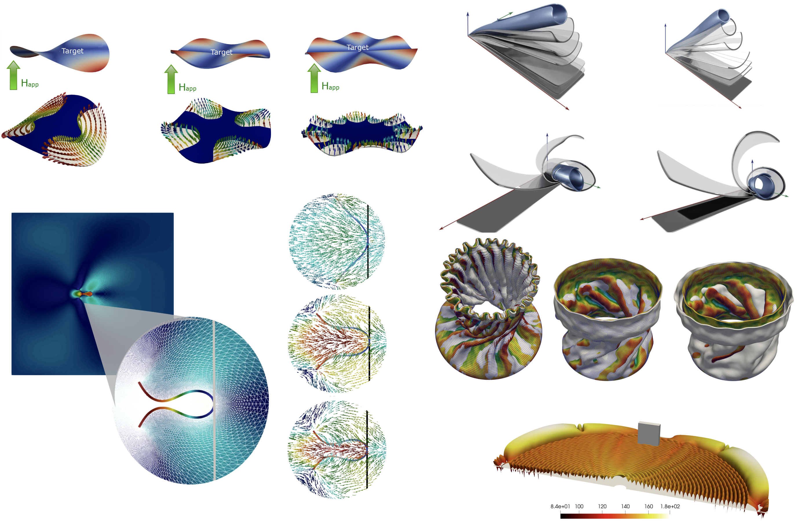

<p align="center"></p>

[](https://multisimolab.github.io/HyperFEM.jl/stable/)
[](https://multisimolab.github.io/HyperFEM.jl/dev/)
[](https://github.com/MultiSimOLab/HyperFEM/actions/workflows/ci.yml?branch=main)
[](https://codecov.io/gh/jmartfrut/HyperFEM.jl)

# Multiphysics Simulation of Multifunctional Soft Materials

**HyperFEM** is a library within the [Gridap](https://github.com/gridap/Gridap.jl) ecosystem designed for the simulation of multiphysics problems involving multifunctional hyperelastic materials. The ultimate goal of HyperFEM is to provide a **high-level, expressive, and rapid prototyping tool** that accelerates the modeling stages of **Thermo–Electro–Magneto–Mechanical** multiphysics problems. To this end, it includes a comprehensive library of **analytically derived constitutive models** formulated through tensor algebra. In addition, HyperFEM provides abstractions for **monolithic and staggered solution schemes**, extending Gridap’s capabilities in the context of **nonlinear solid mechanics**.


## Installation
Open the Julia REPL, type `]` to enter package mode, and install as follows
```julia
pkg> add HyperFEM
```

## Usage
First, include the main HyperFEM module:
```julia
using HyperFEM
```

Example of a Monolithic implementation for the simulation of Nonlinear ElectroMechanical deformation of dielectric elastomers


```julia
using HyperFEM
using Gridap, GridapGmsh, DrWatson
using Gridap.FESpaces
using WriteVTK


simdir = datadir("sims", "Static_ElectroMechanical")
setupfolder(simdir)

geomodel = GmshDiscreteModel("./test/models/test_static_EM.msh")

# Constitutive model
physmodel_mec = NeoHookean3D(λ=10.0, μ=1.0)
physmodel_elec = IdealDielectric(ε=1.0)
physmodel= ElectroMechModel(mechano=physmodel_mec, electro=physmodel_elec)

# Functionals for Energy and Analytical derivatives
Ψ,∂ΨF, ∂ΨE, ∂ΨFF,∂ΨEF,∂ΨEE   = physmodel()

# Setup integration
order = 1
degree = 2 * order
Ω = Triangulation(geomodel)
dΩ = Measure(Ω, degree)

# Dirichlet boundary conditions 
Du = BoundaryConditions(BoundaryCondition("fixedup", [0.0, 0.0, 0.0]))          # value * load(Λ), load = 1 by default

Dφ = BoundaryConditions(BoundaryCondition("midsuf", 0.0, Λ -> Λ), BoundaryCondition("topsuf", 0.1, Λ -> Λ))

D_bc = MultiFieldBC([Du, Dφ])

# Finite Elements
reffeu = ReferenceFE(lagrangian, VectorValue{3,Float64}, order)
reffeφ = ReferenceFE(lagrangian, Float64, order)

# Test FE Spaces
Vu = TestFESpace(geomodel, reffeu, D_bc[1], conformity=:H1)
Vφ = TestFESpace(geomodel, reffeφ, D_bc[2], conformity=:H1)

# Trial FE Spaces
Uu = TrialFESpace(Vu, D_bc[1], 1.0)
Uφ = TrialFESpace(Vφ, D_bc[2], 1.0)

# Multifield FE Spaces
V = MultiFieldFESpace([Vu, Vφ])
U = MultiFieldFESpace([Uu, Uφ])

# Kinematic Description
km=Kinematics(Mechano,Solid)
ke=Kinematics(Electro,Solid)

F,_,_ = get_Kinematics(km)
E     = get_Kinematics(ke)

# residual and jacobian function of load factor
res(Λ)= ((u, φ), (v, vφ)) ->   ∫(∇(v)' ⊙ (∂ΨF ∘ (F∘∇(u)', E∘∇(φ))))dΩ -
                                ∫(∇(vφ) ⋅ (∂ΨE ∘ (F∘∇(u)', E∘∇(φ))))dΩ

jac(Λ)= ((u, φ), (du, dφ), (v, vφ)) -> ∫(∇(v)' ⊙ ((∂ΨFF ∘ (F∘∇(u)', E∘∇(φ))) ⊙ ∇(du)'))dΩ +
                                        ∫(∇(vφ)' ⋅ ((∂ΨEE ∘ (F∘∇(u)', E∘∇(φ))) ⋅ ∇(dφ)))dΩ -
                                        ∫(∇(dφ) ⋅ ((∂ΨEF ∘ (F∘∇(u)', E∘∇(φ))) ⊙ ∇(v)'))dΩ -
                                        ∫(∇(vφ) ⋅ ((∂ΨEF ∘ (F∘∇(u)', E∘∇(φ))) ⊙ ∇(du)'))dΩ 
# nonlinear solver (LU here; see "Solvers for large problems" below)
nls_ = NewtonRaphson(LUSolver(); maxiter=20, atol=1.e-10, rtol=1.e-8, verbose=true)

# Computational model
comp_model = StaticNonlinearModel(res, jac, U, V, D_bc; nls=nls_)

# Postprocessor to save results
function driverpost(post; Ω=Ω, U=U)
    state = post.comp_model.caches.x
    Λ_ = post.iter

    xh = FEFunction(U, state)
    uh = xh[1]
    φh = xh[2]
    pvd = post.cachevtk[3]
    filePath = post.cachevtk[2]

    if post.cachevtk[1]
        pvd[Λ_] = createvtk(Ω,filePath * "/TIME_$Λ_" * ".vtu",cellfields=["u" => uh, "φ" => φh])
    end
end

post_model = PostProcessor(comp_model, driverpost; is_vtk=true, filepath=simdir)

# Solve
x = solve!(comp_model; stepping=(nsteps=5, maxbisec=5), post=post_model)
```

## Solvers for large problems

`NewtonRaphson` accepts any Gridap `LinearSolver`. Beyond ~100k degrees of freedom in 3D the LU factorisation
dominates the time and the memory of every Newton iteration; HyperFEM then provides, with `using GridapPETSc`
(PETSc through GridapPETSc, serial), Krylov solvers preconditioned by algebraic multigrid on the assembled
tangent, and the direct solver MUMPS:

```julia
using GridapPETSc

# Multi-field problems (u, φ): GMRES with a block (fieldsplit) preconditioner, one AMG per field with
# rigid-body modes on the displacement block, rebuilt every 3 Newton iterations (reuse), and an inexact
# Newton (forcing): every linear solve only as tight as the Newton needs. The production configuration for
# electro- and magneto-mechanics.
nls = NewtonRaphson(PETScSolver(U; reuse=3); maxiter=20, rtol=1.e-8, forcing=EisenstatWalker())

# Mechanics (single vector field, P1/Q1): CG + GAMG with the rigid-body modes of the space.
nls = NewtonRaphson(PETScSolver(:cg, :gamg; nullspace=near_nullspace(U)); rtol=1.e-8)

# Direct solver with a fraction of the memory of LU: the reference, and the solver for thin structures
# (few elements across the thickness), where algebraic multigrid does not converge.
nls = NewtonRaphson(PETScSolver(:preonly, :mumps); rtol=1.e-8)
```

Krylov tolerances (`rtol`, `atol = 0`) are relative to the right-hand side; `reuse = n` keeps the
preconditioner for `n` Newton iterations; `forcing = EisenstatWalker()` lets the Newton choose the tolerance of
every linear solve (loose far from the solution, tight near it). Neither is the default, because both change
the Newton trajectory (a few more Newton iterations, far fewer Krylov iterations and preconditioner builds):
on electro- and magneto-mechanical benchmarks of 100k–240k dofs the configuration above solved ×1.9–2.2
faster than `PETScSolver(U)` with exact linear solves. The pure-Julia counterpart `AMGSolver(U)` (with
`using AlgebraicMultigrid`) runs the same block preconditioners without PETSc and is what the test suite
uses. Assembly can be delegated to compiled, threaded kernels with `backend=:compiled` in the drivers
(`using HyperFEMKernels`); with an iterative solver this is what makes the assembly negligible.

With `backend = CompiledBackend(jacobian = :matrixfree)` the nonlinear drivers never assemble the tangent
for the Krylov solver: HyperFEMKernels applies it matrix-free and `MatrixFreeSolver` (GMRES, FGMRES or CG
from Krylov.jl) solves the Newton systems on that operator. The preconditioner is a slot;
`LaggedAssembled(solver; every = k)` assembles and factorises the tangent only every `k` Newton iterations
and preconditions with it in between, so the Newton keeps the exact tangent (same trajectory as a direct
solver) with a fraction of the factorisations:

```julia
using HyperFEMKernels, GridapPETSc
using HyperFEMKernels: MatrixFreeSolver, LaggedAssembled

ls  = MatrixFreeSolver(; krylov = :gmres, rtol = 1e-10,
                       preconditioner = LaggedAssembled(PETScSolver(:preonly, :mumps); every = 3))
nls = NewtonRaphson(ls; maxiter = 20, rtol = 1e-8)
m   = StaticNonlinearModel(res, jac, U, V, D; nls, backend = CompiledBackend(jacobian = :matrixfree))
```

On a thin electro-mechanical Q2 hexahedral benchmark, where algebraic multigrid does not converge and MUMPS
is the reference, this configuration took the same 20 Newton iterations as MUMPS and solved ×2.3 (57k dofs)
and ×5.0 (218k dofs) faster (our measurement: Mac, 6 Julia threads, PETSc serial). On simplices the
matrix-free product is slower than the assembled one; there the assembled configurations above remain the
choice.

## Staggered (partitioned) models

A coupled problem can also be solved field by field: `StaggeredModel` takes one computational model per
field (`StaticNonlinearModel`s), the states the models solve for and their lagged copies, through which the
forms and the `Coupling` conditions of a field read the other fields. The loop advances a stage τ from 0
to 1 by steps; in every step the models are solved one after another (a *pass*), each over its own inner
loop with the load of the step, and the lagged states are set to the new ones after every pass:

```julia
# electrics with the lagged deformation, mechanics with the new potential (uh⁺, φh⁺: states; uh⁻, φh⁻: lagged)
mech(Λ) = uh⁻ + (uh⁺ - uh⁻) * Λ                      # Λ: stage of the inner solve, 0 → 1 within a step
res_elec(Λ) = (φ, vφ) -> residual(physmodel, Electro, k, (mech(Λ), φ), vφ, dΩ)
res_mec(Λ)  = (u, v)  -> residual(physmodel, Mechano, k, (u, φh⁺), v, dΩ)
m_elec = StaticNonlinearModel(res_elec, jac_elec, Uφ, Vφ, Dφ; nls, xh=φh⁺)
m_mec  = StaticNonlinearModel(res_mec,  jac_mec,  Uu, Vu, Du; nls, xh=uh⁺)
sm = StaggeredModel((m_elec, m_mec), (φh⁺, uh⁺), (φh⁻, uh⁻))
args = ((stepping=(nsteps=1, maxbisec=2),), (stepping=(nsteps=1, maxbisec=2),))   # keywords of each inner solve!

# fixed loop: 100 steps of one pass each (the result depends on the number of steps)
x, flag = solve!(sm; stepping=StaggeredStepping(nsteps=100), kargsolve=args)

# coupling converged in every step: few steps, passes until the relative increment of every field is ≤ 1e-6
# (Aitken relaxation of the displacement; a failed step is bisected, an easy one lets the increment grow)
x, flag = solve!(sm; stepping=StaggeredStepping(nsteps=10, max_substeps=30, coupling_tol=1e-6,
                                                relaxation=(:none, Aitken()), grow=2.0, easy=4), kargsolve=args,
                 presolver=(τ⁻, Δτ) -> ramp!(τ⁻ + Δτ),   # a load ramped by the loop reads the stage of the step
                 on_step=(τ, Δτ, nsub) -> @info "τ = $τ in $nsub passes")
log = get_log(sm)          # τ, Δτ, passes, coupling errors, relaxation factors and times per step
```

With `coupling_tol = nothing` (the default) the loop is the fixed one of earlier versions: `nsteps` equal steps
of `max_substeps` passes, whatever the convergence (the `NamedTuple` `(nsteps=…, nsubsteps=…, maxbisec=…)`
is still accepted and selects it). With a tolerance, the passes of a step stop when every field is converged
(`norm = :increment`, the relative increment of the free values of the field in the pass; `norm = :residual`,
the residual of the field at the new state of the others relative to the one of the first pass); a step whose
passes reach `max_substeps` without convergence, or in which an inner solve fails, is rejected: the states, the
lagged states and the Dirichlet values return to the last accepted step and the increment is bisected
(`maxbisec` consecutive bisections at most); after a step accepted in at most `easy` passes the increment grows
by `grow`, never beyond the initial one. `relaxation` is `:none`, a factor, `:aitken`/`Aitken(; ω0, ωmin, ωmax)`
or a tuple with one of them per field; the factor of a field whose model has an `injectivity` measure and an
`InjectivityLS` is cut so that the relaxed state does not invert elements. The post-processors of the inner
models run inside every pass; output per accepted step belongs in `on_step`.

## HyperFEM Gallery



 

## How to cite HyperFEM

In order to give credit to the HyperFEM contributors, we ask that you please reference the paper:

C. Perez‐Garcia, R. Ortigosa, J. Martínez‐Frutos, and D. Garcia‐Gonzalez, **Topology and material optimization in ultra-soft magnetoactive structures: making advantage of residual anisotropies.** Adv. Mater. (2025): e18489. https://doi.org/10.1002/adma.202518489

along with the required citations for [Gridap](https://github.com/gridap/Gridap.jl).


## Project funded by
 
- Grants PID2022-141957OA-C22/PID2022-141957OB-C22  funded by MCIN/AEI/ 10.13039/501100011033  and by ''ERDF A way of making Europe''

<p align="center"></p>

##  Contact

Contact the project administrator [Jesús Martínez-Frutos](mailto:jesus.martinez@upct.es) for further questions about licenses and terms of use.
