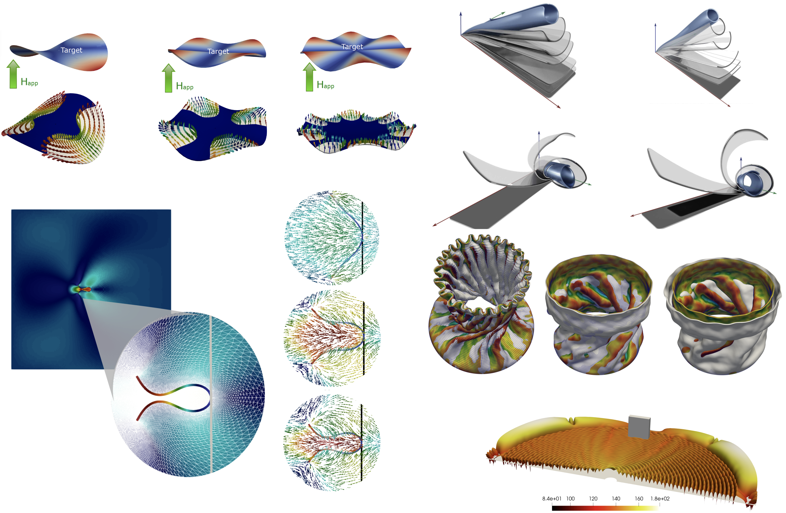

<p align="center"></p>

[](https://multisimolab.github.io/HyperFEM.jl/stable/)
[](https://multisimolab.github.io/HyperFEM.jl/dev/)
[](https://github.com/MultiSimOLab/HyperFEM.jl/actions/workflows/ci.yml?branch=main)
[](https://codecov.io/gh/MultiSimOLab/HyperFEM.jl)

# Multiphysics Simulation of Multifunctional Soft Materials

**HyperFEM** is a library within the [Gridap](https://github.com/gridap/Gridap.jl) ecosystem for the simulation of
**thermo–electro–magneto–mechanical** problems in multifunctional hyperelastic materials. It provides:

- a library of constitutive models with **analytical derivatives**, written with tensor algebra;
- weak forms, boundary conditions and **monolithic, staggered and transient** drivers for nonlinear solid mechanics;
- adaptive load stepping, Newton–Raphson with line searches, and solvers for large problems (PETSc, algebraic and
  geometric multigrid, matrix-free Newton with compiled kernels through `HyperFEMKernels`).

## Installation

```julia
pkg> add HyperFEM
```

## Usage

Monolithic simulation of the nonlinear electro-mechanical deformation of a dielectric elastomer:

```julia
using HyperFEM
using Gridap, GridapGmsh, DrWatson
using Gridap.FESpaces
using WriteVTK


simdir = datadir("sims", "Static_ElectroMechanical")
setupfolder(simdir)

geomodel = GmshDiscreteModel("./test/models/test_static_EM.msh")

# Constitutive model
physmodel_mec = NeoHookean3D(λ=10.0, μ=1.0)
physmodel_elec = IdealDielectric(ε=1.0)
physmodel= ElectroMechModel(mechano=physmodel_mec, electro=physmodel_elec)

# Functionals for Energy and Analytical derivatives
Ψ,∂ΨF, ∂ΨE, ∂ΨFF,∂ΨEF,∂ΨEE   = physmodel()

# Setup integration
order = 1
degree = 2 * order
Ω = Triangulation(geomodel)
dΩ = Measure(Ω, degree)

# Dirichlet boundary conditions 
Du = BoundaryConditions(BoundaryCondition("fixedup", [0.0, 0.0, 0.0]))          # value * load(Λ), load = 1 by default

Dφ = BoundaryConditions(BoundaryCondition("midsuf", 0.0, Λ -> Λ), BoundaryCondition("topsuf", 0.1, Λ -> Λ))

D_bc = MultiFieldBC([Du, Dφ])

# Finite Elements
reffeu = ReferenceFE(lagrangian, VectorValue{3,Float64}, order)
reffeφ = ReferenceFE(lagrangian, Float64, order)

# Test FE Spaces
Vu = TestFESpace(geomodel, reffeu, D_bc[1], conformity=:H1)
Vφ = TestFESpace(geomodel, reffeφ, D_bc[2], conformity=:H1)

# Trial FE Spaces
Uu = TrialFESpace(Vu, D_bc[1], 1.0)
Uφ = TrialFESpace(Vφ, D_bc[2], 1.0)

# Multifield FE Spaces
V = MultiFieldFESpace([Vu, Vφ])
U = MultiFieldFESpace([Uu, Uφ])

# Kinematic Description
km=Kinematics(Mechano,Solid)
ke=Kinematics(Electro,Solid)

F,_,_ = get_Kinematics(km)
E     = get_Kinematics(ke)

# residual and jacobian function of load factor
res(Λ)= ((u, φ), (v, vφ)) ->   ∫(∇(v)' ⊙ (∂ΨF ∘ (F∘∇(u)', E∘∇(φ))))dΩ -
                                ∫(∇(vφ) ⋅ (∂ΨE ∘ (F∘∇(u)', E∘∇(φ))))dΩ

jac(Λ)= ((u, φ), (du, dφ), (v, vφ)) -> ∫(∇(v)' ⊙ ((∂ΨFF ∘ (F∘∇(u)', E∘∇(φ))) ⋅² ∇(du)'))dΩ +
                                        ∫(∇(vφ)' ⋅ ((∂ΨEE ∘ (F∘∇(u)', E∘∇(φ))) ⋅ ∇(dφ)))dΩ -
                                        ∫(∇(dφ) ⋅ ((∂ΨEF ∘ (F∘∇(u)', E∘∇(φ))) ⋅² ∇(v)'))dΩ -
                                        ∫(∇(vφ) ⋅ ((∂ΨEF ∘ (F∘∇(u)', E∘∇(φ))) ⋅² ∇(du)'))dΩ 
# nonlinear solver (LU here; see "Load stepping and solvers" in the documentation for large problems)
nls_ = NewtonRaphson(LUSolver(); maxiter=20, atol=1.e-10, rtol=1.e-8, verbose=true)

# Computational model
comp_model = StaticNonlinearModel(res, jac, U, V, D_bc; nls=nls_)

# Postprocessor to save results
function driverpost(post; Ω=Ω, U=U)
    state = post.comp_model.caches.x
    Λ_ = post.iter

    xh = FEFunction(U, state)
    uh = xh[1]
    φh = xh[2]
    pvd = post.cachevtk[3]
    filePath = post.cachevtk[2]

    if post.cachevtk[1]
        pvd[Λ_] = createvtk(Ω,filePath * "/TIME_$Λ_" * ".vtu",cellfields=["u" => uh, "φ" => φh])
    end
end

post_model = PostProcessor(comp_model, driverpost; is_vtk=true, filepath=simdir)

# Solve
x = solve!(comp_model; stepping=(nsteps=5, maxbisec=5), post=post_model)
```

`stepping` controls the load increments (Λ from 0 to 1, bisection of failed increments). More examples are in the
[tutorials](https://multisimolab.github.io/HyperFEM.jl/dev/tutorials/).

## Documentation

- [Load stepping and solvers](https://multisimolab.github.io/HyperFEM.jl/dev/solvers/): adaptive stepping, PETSc, matrix-free Newton
  and geometric multigrid for large problems.
- [Staggered models](https://multisimolab.github.io/HyperFEM.jl/dev/staggered/): field-by-field solution and coupling between meshes
  (`Coupling`, `Transfer`).
- [Time integration](https://multisimolab.github.io/HyperFEM.jl/dev/transient/), [tensor algebra](https://multisimolab.github.io/HyperFEM.jl/dev/tensor_algebra/)
  and the [API reference](https://multisimolab.github.io/HyperFEM.jl/dev/api/).

## HyperFEM Gallery



 

## How to cite HyperFEM

In order to give credit to the HyperFEM contributors, we ask that you please reference the paper:

C. Perez‐Garcia, R. Ortigosa, J. Martínez‐Frutos, and D. Garcia‐Gonzalez, **Topology and material optimization in ultra-soft magnetoactive structures: making advantage of residual anisotropies.** Adv. Mater. (2025): e18489. https://doi.org/10.1002/adma.202518489

along with the required citations for [Gridap](https://github.com/gridap/Gridap.jl).


## Project funded by
 
- Grants PID2022-141957OA-C22/PID2022-141957OB-C22  funded by MCIN/AEI/ 10.13039/501100011033  and by ''ERDF A way of making Europe''

<p align="center"></p>

##  Contact

Contact the project administrator [Jesús Martínez-Frutos](mailto:jesus.martinez@upct.es) for further questions about licenses and terms of use.
